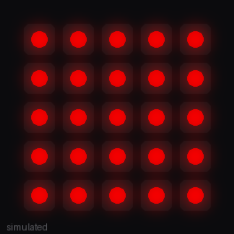

# PixelDeck

[](https://github.com/atahan99/PixelDeck/actions/workflows/build.yml)

Four-mode custom firmware for the
[M5Stack Atom Matrix](https://docs.m5stack.com/en/core/ATOM%20Matrix), a 24 mm
ESP32 cube with a 5×5 RGB LED matrix, one button and a motion sensor. One of
three M5Stack firmwares, alongside [DialHA](https://github.com/atahan99/DialHA)
and [PocketDeck](https://github.com/atahan99/PocketDeck).

<p align="center"></p>
<p align="center"><sub>Simulated render (<code>scripts/render_gif.py</code>), not a camera capture.</sub></p>

## Modes

| # | Mode | What it does |
|---|------|--------------|
| **1** | Rainbow | Scrolling rainbow across all 25 LEDs |
| **2** | Static | One random color or shape, frozen until the next click |
| **3** | Animated | A new random pattern every 200 ms |
| **4** | Wi‑Fi | One LED per 2.4 GHz access point, strongest first (max 25). Color = security, brightness = signal |

## Controls

- **Click:** next mode (1 → 2 → 3 → 4 → 1). The new mode's number flashes first. Clicks register at any time, even mid-scan.
- **Long-press in Wi‑Fi mode:** shows how many networks the last scan found, digit by digit (`17` = `1`, then `7`).
- **Tilt:** the picture rotates to stay upright.
- **Power cycle:** comes back in the last mode used.

Boot: all LEDs flash red for a moment (LED check), then the saved mode's number.

### Wi‑Fi colors

| Security | Color |
|----------|-------|
| Open | Red |
| WEP | Orange |
| WPA | Yellow |
| WPA2 (Personal or Enterprise) | Green |
| WPA3 | Cyan |
| Anything else (WAPI, OWE "Enhanced Open", …) | Magenta |

Color shows the protocol only. Green means WPA2 or better, not that a network is
safe: a WPA2 network with a weak password is still weak. The scan is a normal
scan (it sends standard probe requests, like any phone) and never joins a
network. The firmware holds no credentials and logs no network names, only
counts.

## Flash it

Grab `pixeldeck-<version>.bin` and `SHA256SUMS` from the
[latest release](https://github.com/atahan99/PixelDeck/releases/latest). It is a
merged image (bootloader + partitions + app), so it goes at offset `0x0`.

```bash
shasum -a 256 -c SHA256SUMS
```

```bash
esptool.py --chip esp32 --port /dev/cu.usbserial-XXXXXXXX write_flash 0x0 pixeldeck-1.1.0.bin
```

`pio device list` shows the port. With **M5Burner**, upload the same `.bin`
under *User Custom* for the ATOM series.

## Build from source

Needs [PlatformIO](https://platformio.org/). Platform and libraries are pinned in
`platformio.ini`, so a given commit always builds the same firmware.

```bash
pio run -t upload --upload-port /dev/cu.usbserial-XXXXXXXX
```

```bash
pio run -t firmware    # → firmware/pixeldeck-1.1.0.bin (merged, flash at 0x0)
```

The Wi‑Fi color and signal mapping lives in `src/wifi_style.h` with no hardware
dependencies, so it is tested on the host:

```bash
c++ -std=c++17 -Wall -Wextra -I src test/test_wifi_style.cpp -o /tmp/wifi_style_check && /tmp/wifi_style_check
```

CI runs that test and the firmware build on every push. Pushing a `v*` tag
publishes the merged `.bin` and its checksum as a GitHub Release.

## How it works

**LEDs through Adafruit NeoPixel, not M5Unified.** The obvious route,
`M5.Led`, drives LEDs through the ESP32's RMT peripheral, and on this toolchain
(Arduino‑ESP32 2.0.x / ESP‑IDF 4.4) it silently does nothing. The matrix is a
plain WS2812 chain on GPIO27 (`NEO_GRB`), which is what M5Stack's own Atom
examples drive with NeoPixel. M5Unified is still used for the button and the
motion sensor.

**Brightness capped at 20/255.** The 25 LEDs sit millimetres under a plastic
diffuser, and M5Stack warns that the Atom Matrix overheats above about 20. The
cap is a build flag (`MAX_BRIGHTNESS`) with a `static_assert` so it can't
quietly be raised past the limit. Wi‑Fi signal strength scales each color
within that cap, with a floor so weak networks stay visible.

**Nothing blocks the loop.** A synchronous Wi‑Fi scan holds the CPU for up to
~4 s (300 ms on each of 13 channels), long enough to swallow button clicks. The
scan runs asynchronously, and the loop polls `WiFi.scanComplete()`. The mode
number is an overlay with a deadline instead of a `delay()`, drawn over the mode,
which keeps running underneath.

**The radio is only on in Wi‑Fi mode.** Leaving mode 4 turns Wi‑Fi off, so the
light modes don't pay for an idle radio in heat or power.

**One frame buffer, rotated on the way out.** Every mode draws into an upright
5×5 buffer, and a single function maps it to physical LEDs using the current
rotation from the accelerometer. Lying flat keeps the last orientation. The
sensor is started with the Atom Matrix board ID explicitly, because the board
can autodetect as an Atom Lite, which skips the Matrix axis correction.

**Last mode in flash.** The mode is saved to NVS (`Preferences`) on each click.
Writes only happen on a button press, so flash wear isn't a concern.

There is no microphone on this device, so a music visualizer is out of scope.

## License

MIT, see [LICENSE](LICENSE). Bundled libraries keep their own licenses, listed
in [THIRD-PARTY.md](THIRD-PARTY.md).
